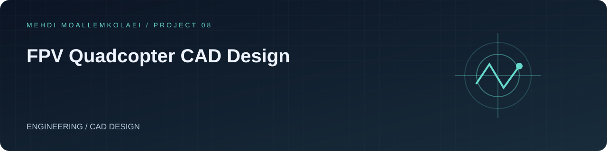

# FPV Quadcopter CAD Design

**Document a quadcopter assembly with parts, drawings and exploded views.**

SolidWorks 2022 � Assembly design � CAD

[Overview](#overview) � [Design](portfolio/DESIGN.md) � [Setup](portfolio/SETUP.md) � [Validation](portfolio/VALIDATION.md) � [Evidence](portfolio/EVIDENCE.md)

<!-- project-navigation:start -->

  
  
  
  

<strong>CAD design</strong> &nbsp; / &nbsp; Engineering &nbsp; / &nbsp; <a href="https://ace-alch.github.io/">Mehdi's portfolio</a>

<!-- project-navigation:end -->

## Overview

| Item | Record |
| :-- | :-- |
| Project type | CAD design |
| Field | Engineering |
| Material in this package | Existing repository inspected |
| Documentation review | 17 November 2026 |

## Scope

Document a quadcopter assembly with parts, drawings and exploded views. The documentation separates the stated project scope, inspected artifacts and future work. A listed feature is not a new test result.

### Main elements

- Frame parts
- Motor and propeller parts
- Assembly mates
- Exploded view

## Explore the project

| Design | Setup | Validation | Evidence |
| :-- | :-- | :-- | :-- |
| [System and boundaries](portfolio/DESIGN.md) | [Available entry points](portfolio/SETUP.md) | [Test plan](portfolio/VALIDATION.md) | [Verified material](portfolio/EVIDENCE.md) |

## Technical limits

The repository contains native SolidWorks parts, an assembly, PDF drawings, a GIF and a video. STEP and STL exports were not present in the inspected tree. The separate DJI simulation does not prove that a physical flight controller was integrated into this CAD assembly.

## Project preview

This image is an existing repository artifact. It is not evidence of a new test.

<strong>Browse source files and project artifacts</strong>

| Path | Type |
| :-- | :-- |
| [CAD/Assem1.SLDASM](https://github.com/Ace-Alch/CAD_FPV_Drone/blob/main/CAD/Assem1.SLDASM) | .SLDASM |
| [CAD/Electrical Connector.SLDPRT](https://github.com/Ace-Alch/CAD_FPV_Drone/blob/main/CAD/Electrical%20Connector.SLDPRT) | .SLDPRT |
| [CAD/Spacer.SLDPRT](https://github.com/Ace-Alch/CAD_FPV_Drone/blob/main/CAD/Spacer.SLDPRT) | .SLDPRT |
| [CAD/Spider Arm.SLDPRT](https://github.com/Ace-Alch/CAD_FPV_Drone/blob/main/CAD/Spider%20Arm.SLDPRT) | .SLDPRT |
| [CAD/Spider Base.SLDPRT](https://github.com/Ace-Alch/CAD_FPV_Drone/blob/main/CAD/Spider%20Base.SLDPRT) | .SLDPRT |
| [CAD/Spider Top.SLDPRT](https://github.com/Ace-Alch/CAD_FPV_Drone/blob/main/CAD/Spider%20Top.SLDPRT) | .SLDPRT |
| [CAD/Spinner.SLDPRT](https://github.com/Ace-Alch/CAD_FPV_Drone/blob/main/CAD/Spinner.SLDPRT) | .SLDPRT |
| [CAD/dist Board.SLDPRT](https://github.com/Ace-Alch/CAD_FPV_Drone/blob/main/CAD/dist%20Board.SLDPRT) | .SLDPRT |
| [CAD/elecPin1.SLDPRT](https://github.com/Ace-Alch/CAD_FPV_Drone/blob/main/CAD/elecPin1.SLDPRT) | .SLDPRT |
| [CAD/elecPin2.SLDPRT](https://github.com/Ace-Alch/CAD_FPV_Drone/blob/main/CAD/elecPin2.SLDPRT) | .SLDPRT |
| [CAD/motor.SLDPRT](https://github.com/Ace-Alch/CAD_FPV_Drone/blob/main/CAD/motor.SLDPRT) | .SLDPRT |
| [CAD/piller.SLDPRT](https://github.com/Ace-Alch/CAD_FPV_Drone/blob/main/CAD/piller.SLDPRT) | .SLDPRT |

See the [complete source inventory](portfolio/SOURCE-INVENTORY.md) for all inspected file paths.

## Next work

- [ ] STEP and STL export evidence
- [ ] Materials and fasteners
- [ ] Mass properties
- [ ] Physical assembly checks

## Credits and reuse

Project record: Mehdi Moallemkolaei. Specific third-party and course contributions must retain their original notices.

Existing license terms remain in effect. This package does not grant a new license over source code, course material, models or datasets. See [reuse and contribution notes](portfolio/CONTRIBUTIONS.md).
